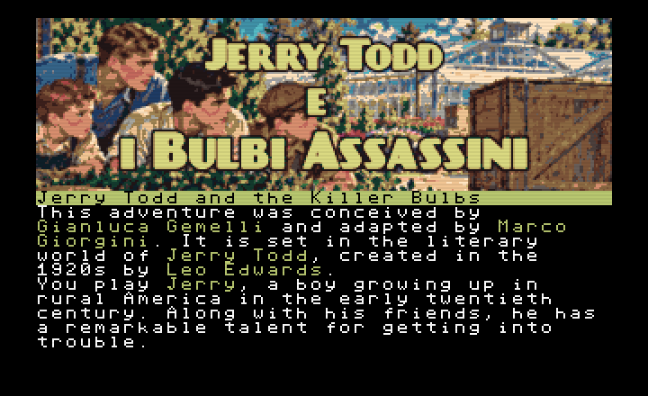

# Jerry Todd and the Killer Bulbs

A sweltering morning, four penniless friends, and a powerful craving for ice cream. What could possibly go wrong?

Cap Tinkertop promised to pay Jerry and his friends for helping with a few jobs. But when the boys arrive at his house, Cap is nowhere to be found. A note leads them to the Bulbs’ nursery, where a simple search soon becomes an adventure involving suspicious footprints, secret stakeouts, and crates with mysterious contents.

In this short illustrated text adventure, you play Jerry Todd. Alongside you are Scoop, always ready with a plan; Red, with an eye for mechanisms and small details; and Peg, the friend to call on when muscle is needed. There’s no need to select which boy should act: enter your commands, and your friends step in when their particular talents can help.

Explore the town and its surroundings, examine objects, follow the clues, and find a way to bring Cap home. If you get stuck, TALK FRIENDS: their suggestions reflect your location and the progress of your investigation.

16 locations to explore, accompanied by illustrations.
Classic text commands and puzzles built around observation and using objects.
A mystery full of friendship, mischief, and the spirit of old-fashioned boys’ adventure stories.
Available in English and Italian.
Set in the literary world of **Jerry Todd**, created by [**Leo Edwards**](https://en.wikipedia.org/wiki/Edward_Edson_Lee), the game is based on a story by [**Gianluca Gemelli**](http://teladoiolanarrativa.blogspot.com/) (Italian Translator for [Jerry Todd](https://www.amazon.it/dp/B09XXWLQSB?binding=paperback&sr=1-8)'s books), adapted by **Marco Giorgini**, and made with **StoryTllr**.

*Work first, ice cream afterwards. Provided the Bulbs agree.*

## Play and download
This game is available in two languages, and you can freely play each of them on itch.io:
- [English](https://marcogiorgini.itch.io/jerry-todd-and-the-killer-bulbs)
- [Italian](https://marcogiorgini.itch.io/jerry-todd-e-i-bulbi-assassini)

## Game Source License
Game source is released under the MIT License. 

## AI disclaimers
This is NOT an AI-generated game, but it contains AI images (so there's *no license* for them), and AI has also been used for testing purposes.
